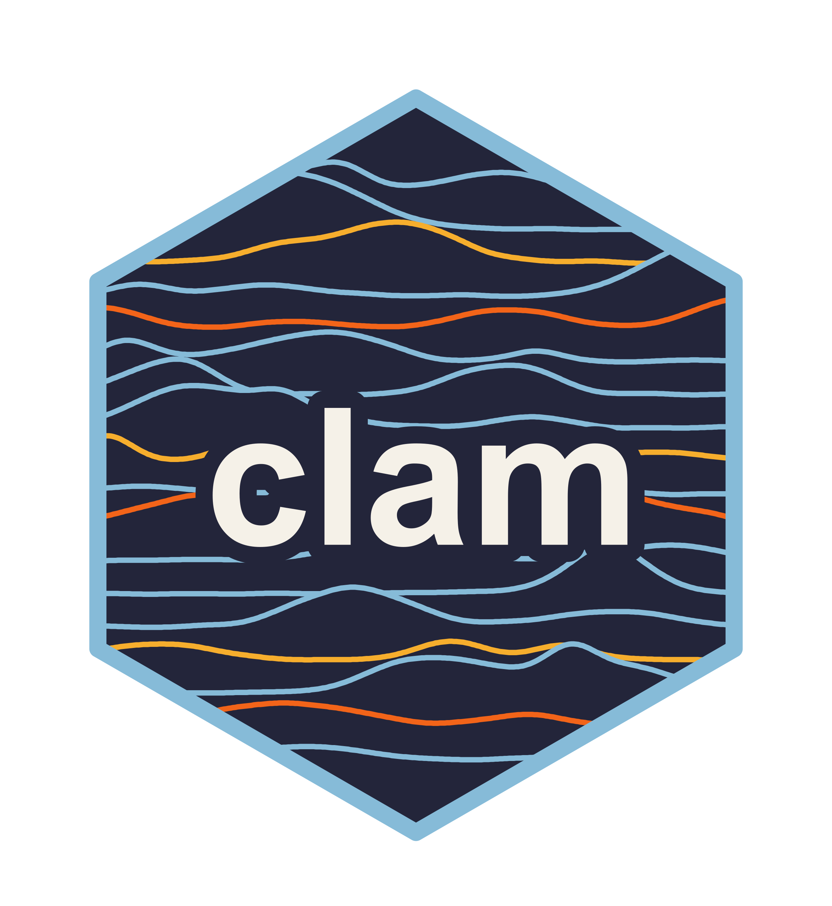

# clam

---

[](https://anaconda.org/bioconda/clam)
[](https://anaconda.org/bioconda/clam)
[](https://anaconda.org/bioconda/clam)
[](https://anaconda.org/bioconda/clam)
[](https://anaconda.org/bioconda/clam)

clam identifies genomic regions with sufficient sequencing depth to be considered "callable" and uses this information to calculate population genetic statistics from VCFs. It eliminates the need to generate an all-sites VCF files while still producing accurate diversity estimates. clam was designed specifically for large population genomics datasets.

## Installation
From bioconda:
```console
conda create -n clam bioconda::clam
```

From source:
```console
git clone https://github.com/cademirch/clam.git
cd clam
cargo build --release
./target/release/clam --help
```

## Basic Use
### Generating callable loci intervals
The clam `loci` command can be used to generate callable loci intervals from sequencing depth data from either alignments or GVCF files. The resulting interval file describes how many samples were callable at each position in the genome.

```bash
clam loci -t 16 -m 10 sample1.d4.gz sample2.d4.gz sample3.d4.gz
```

### Using callable loci intervals to estimate popgen statistics
The clam `stat` command can be used to estimate common population genetic statistics such as π, d<sub>xy</sub>, F<sub>ST</sub>, and heterozygosity in windows. `stat` uses the callable loci Zarr alongside a VCF to produce accurate estimates, even in the presence of missing data.

```bash
clam stat -o results/ -w 10000 -c callable.zarr variants.vcf.gz
```
## Documentation
Read the [documentation](https://cademirch.github.io/clam) for more information.

## License

`clam` is distributed under the terms of the [MIT](https://spdx.org/licenses/MIT.html) license.